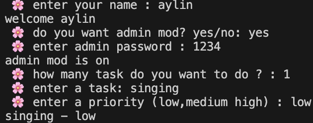
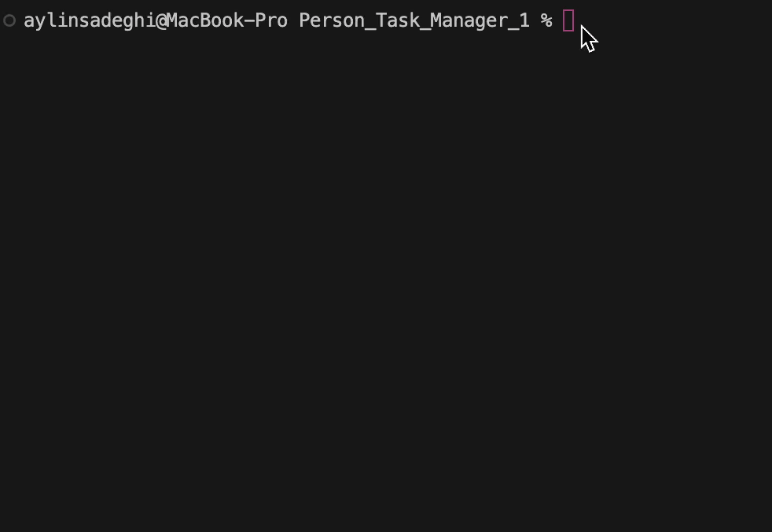

# Personal Task Manager


A symple task manager buld with python

## Features
- add multyple tasks
- save task
- load save task
- admin mode
- set task priority

## Task priority

each task can have one these priority level:

- low
- medium
- high
  
## Requirments

- python
- python-dotenv

## Installation

install the requirment package

```bash
pyton -m pip install -r requirment.txt
```

## Project Structure
```txt
personal_Task_manager/
│   .env.example
│   .gitignore
│   task.py
│   main.py
│   README.md
│   requirements.txt
│
├───photo/
│       screeenshot.png
│____gif
│          gif_1.gif
│______________
```
## Envirment Setup
create a `.env` file folderfroject folder

use `.env.example` as a template 

add you admin password 

```env
admin_pass=your_password_here

```
replace `your_password_here` with your own admin password


## Run the Program
run the main file
```bash
python main.py
```

## Screenshot



## Demo

